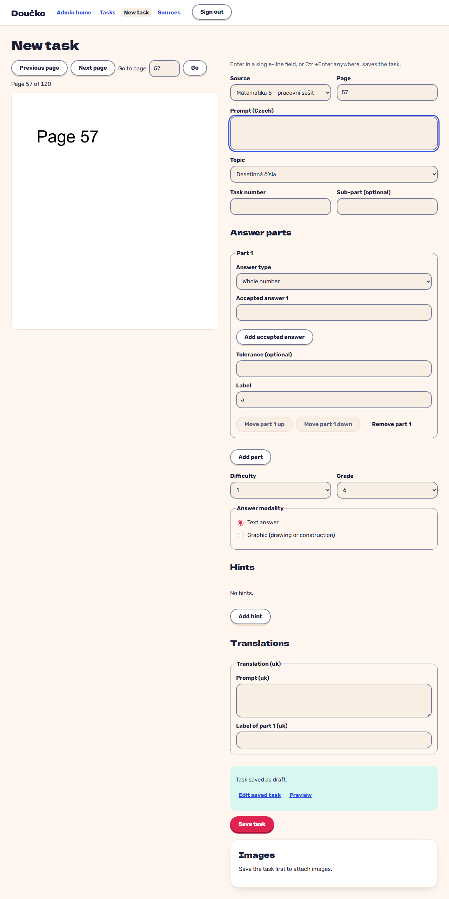

# Typical single-part task entered with the keyboard

**Proves:** NFR-8, FR-3

**Result:** asserted ✓ — saved 5.9 s after the first keystroke (limit 60 s)

Steps (keyboard only, 150 ms per key, 700 ms between fields): the editor opens with the sticky source and page 57 and focus in the prompt; type the prompt, Tab to the topic and pick it with an arrow key, Tab to the task number and type it, Tab past the sub-part and the answer type, type the expected value, press Enter. Asserted: the task is stored as DRAFT with that source reference and one INTEGER part, the time is within 60 s, the page stays 57 and focus returns to the prompt.

Recorded against the production build (`vite preview`) with the admin API answered by the contract stub `src/test/fake-admin-backend.ts` (self-authored data). The real-stack click path is `docs/qa/evidence/slice5-compose-smoke.md`.

