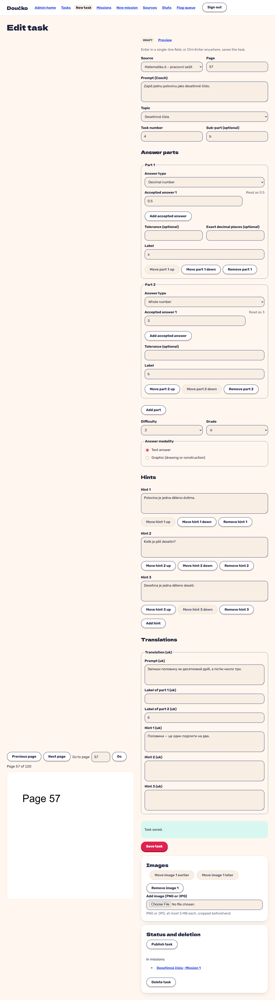

# a task with two answer parts, ordered hints and a Ukrainian translation is saved (FR-6, FR-7, FR-8)

**Proves:** FR-6, FR-7, FR-8

**Result:** asserted ✓

Clip `rec-parts-hints-translations: a task with two answer parts, ordered hints and a Ukrainian translation is saved (FR-6, FR-7, FR-8)` in `e2e/recordings/admin-and-theme.spec.ts`: the steps and every assertion are the test body (Playwright `expect`). Recorded against the production build (`vite preview`) with the API answered by the contract stubs `src/test/fake-admin-backend.ts` / `src/test/fake-child-backend.ts` (self-authored data). The real-stack suite is `e2e/stack/` (docs/qa/e2e-stack-latest.md).

