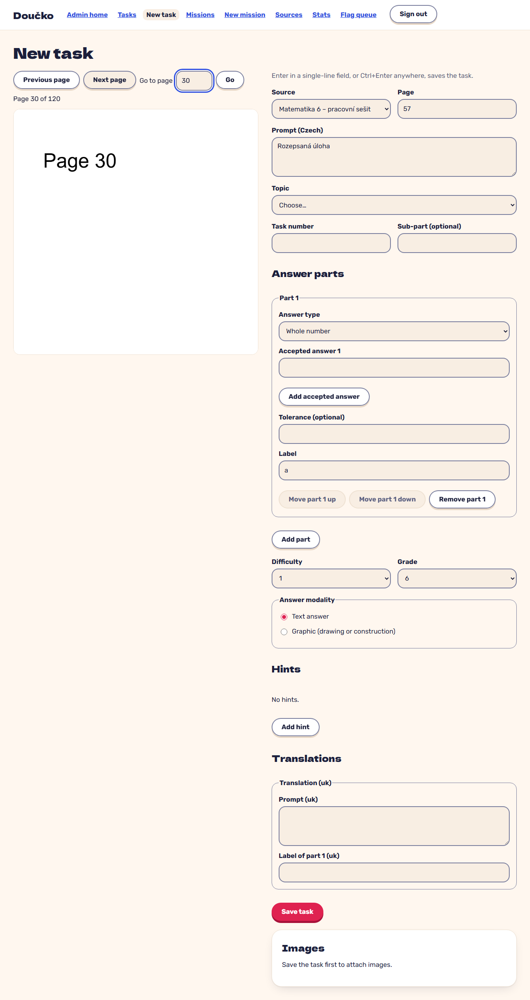

# the PDF viewer beside the task editor jumps to a page; the form keeps its content (FR-2)

**Proves:** FR-2

**Result:** asserted ✓

Clip `rec-pdf-beside-editor: the PDF viewer beside the task editor jumps to a page; the form keeps its content (FR-2)` in `e2e/recordings/admin-and-theme.spec.ts`: the steps and every assertion are the test body (Playwright `expect`). Recorded against the production build (`vite preview`) with the API answered by the contract stubs `src/test/fake-admin-backend.ts` / `src/test/fake-child-backend.ts` (self-authored data). The real-stack suite is `e2e/stack/` (docs/qa/e2e-stack-latest.md).

