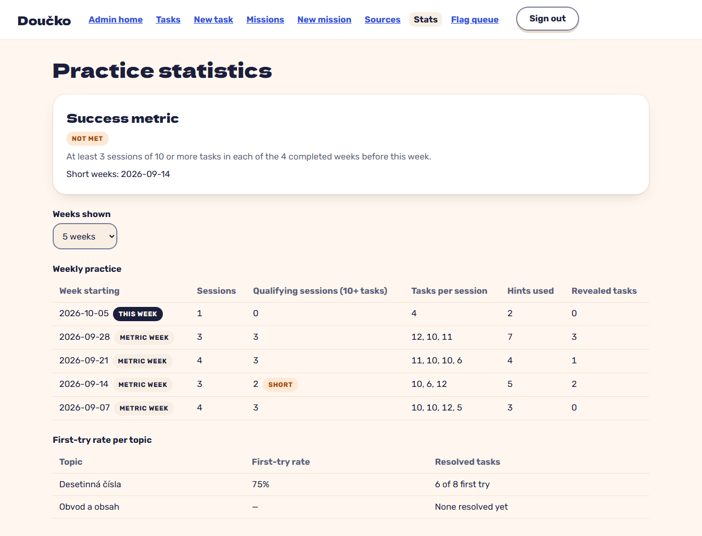

# the stats page shows sessions per week, tasks per session, first-try rate per topic, hints and revealed tasks (FR-40)

**Proves:** FR-40

**Result:** asserted ✓

Clip `rec-stats: the stats page shows sessions per week, tasks per session, first-try rate per topic, hints and revealed tasks (FR-40)` in `e2e/recordings/admin-and-theme.spec.ts`: the steps and every assertion are the test body (Playwright `expect`). Recorded against the production build (`vite preview`) with the API answered by the contract stubs `src/test/fake-admin-backend.ts` / `src/test/fake-child-backend.ts` (self-authored data). The real-stack suite is `e2e/stack/` (docs/qa/e2e-stack-latest.md).

