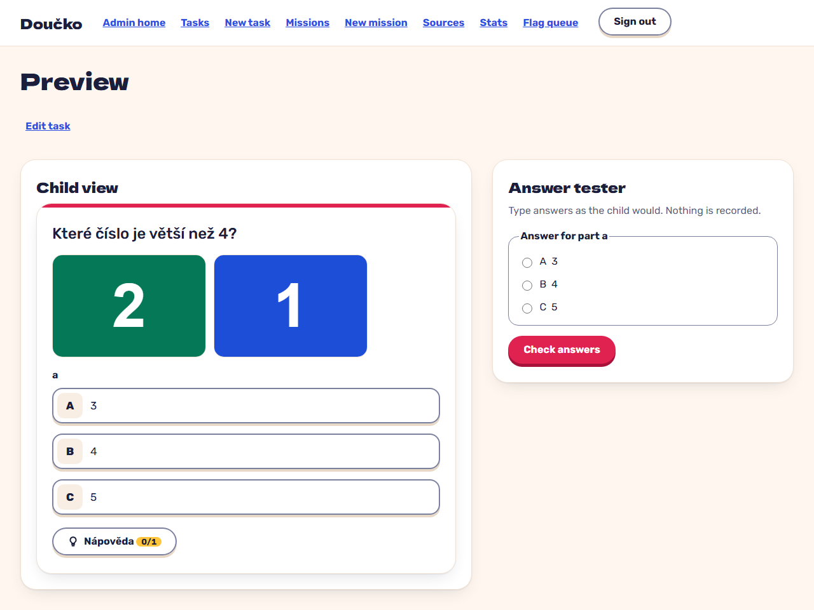

# attach two PNG images and reorder them; the child preview shows them in order (FR-4)

**Proves:** FR-4

**Result:** asserted ✓

Clip `rec-task-images: attach two PNG images and reorder them; the child preview shows them in order (FR-4)` in `e2e/recordings/admin-and-theme.spec.ts`: the steps and every assertion are the test body (Playwright `expect`). Recorded against the production build (`vite preview`) with the API answered by the contract stubs `src/test/fake-admin-backend.ts` / `src/test/fake-child-backend.ts` (self-authored data). The real-stack suite is `e2e/stack/` (docs/qa/e2e-stack-latest.md).

