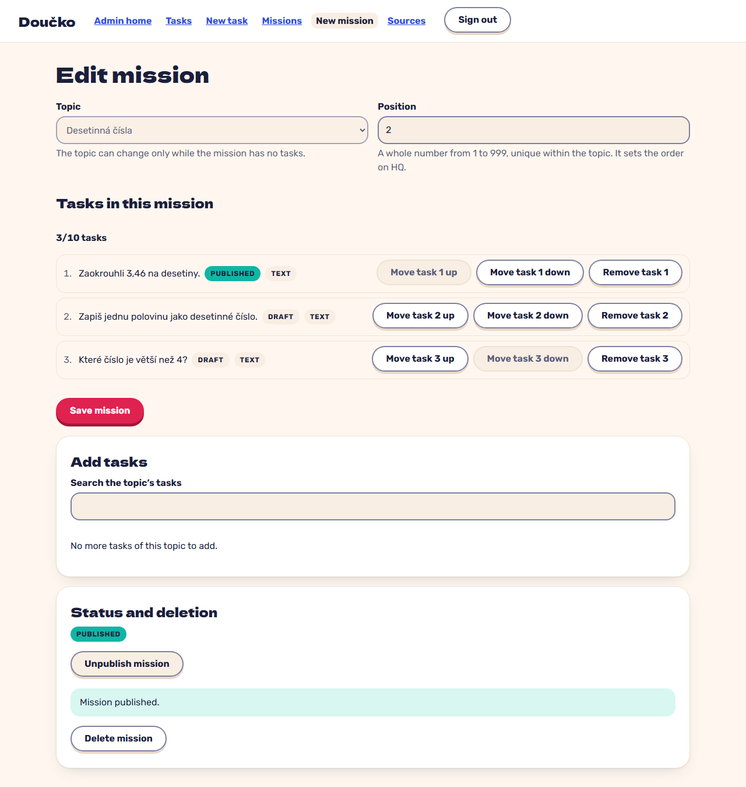

# Create a mission, reorder it and publish it (FR-9, FR-55)

**Proves:** FR-9, FR-55

**Result:** asserted ✓

Open New mission, choose the topic, type position 2, add three tasks of the topic, move the third to the first place with the keyboard, save; publish is refused with the draft tasks named; the tasks get published; publish again. Asserted: the stored mission is DRAFT with the tasks in the new order and the counter 3/10 tasks, the refusal names the blocking tasks, and the mission ends PUBLISHED. The still shows the published mission editor.

Recorded against the production build (`vite preview`) with the admin API answered by the contract stub `src/test/fake-admin-backend.ts` (self-authored data). The real-stack click path is task 4.4 of implement-authoring-missions-ui (after the slice 6 merge).

