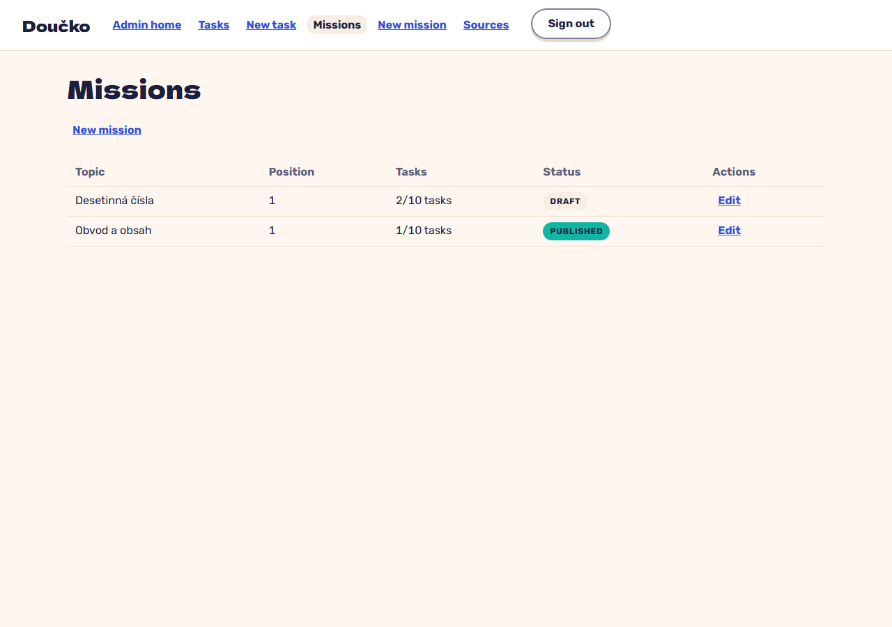

# Mission list by topic and position with counter and status (FR-9)

**Proves:** FR-9

**Result:** asserted ✓

With a draft and a published mission, open Missions from the admin navigation. Asserted: both are listed with topic, position, counter and status. The still shows the list.

Recorded against the production build (`vite preview`) with the admin API answered by the contract stub `src/test/fake-admin-backend.ts` (self-authored data). The real-stack click path is task 4.4 of implement-authoring-missions-ui (after the slice 6 merge).

