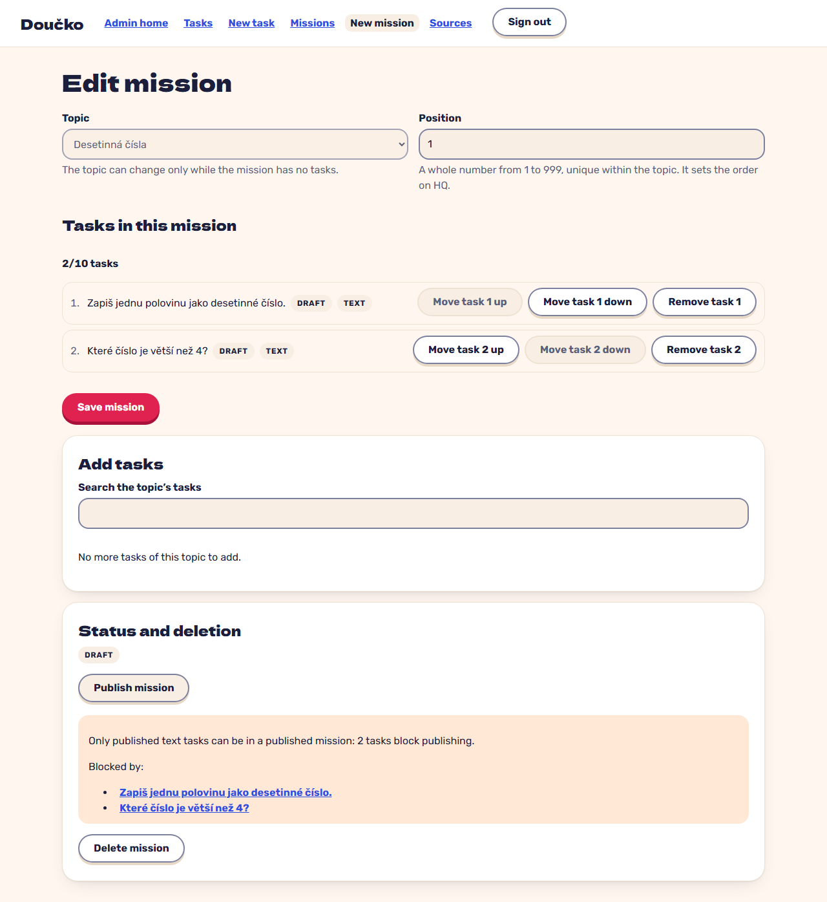

# A refused mission publish names the blocking tasks (FR-9)

**Proves:** FR-9

**Result:** asserted ✓

Open the seeded draft mission whose two tasks are drafts and publish it. Asserted: the alert shows the server reason and links both draft tasks; the mission stays DRAFT. The still shows the refusal next to the task list.

Recorded against the production build (`vite preview`) with the admin API answered by the contract stub `src/test/fake-admin-backend.ts` (self-authored data). The real-stack click path is task 4.4 of implement-authoring-missions-ui (after the slice 6 merge).

