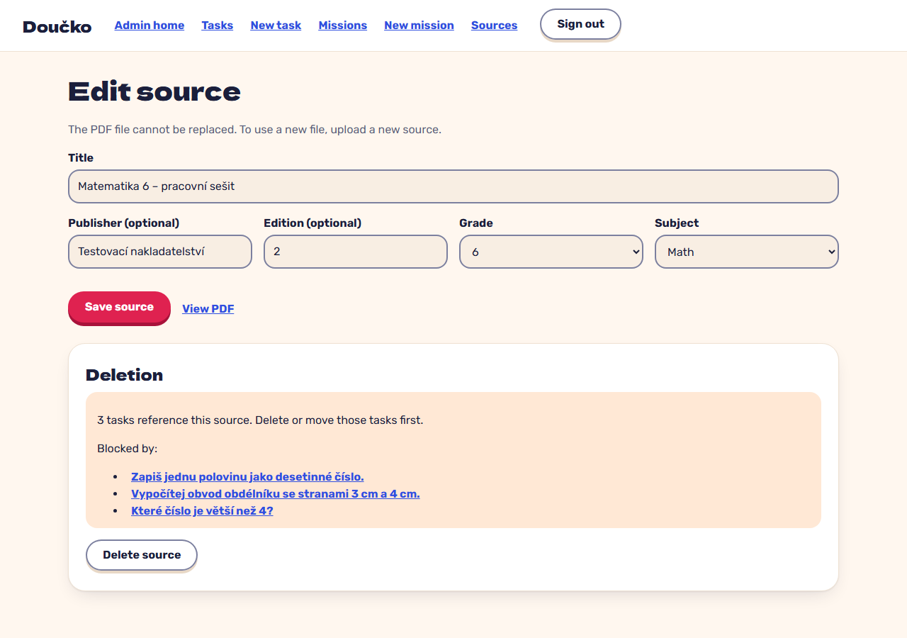

# Edit a source; a referenced source cannot be deleted (FR-55)

**Proves:** FR-55

**Result:** asserted ✓

From the source list choose Edit, change the edition to 2 and press Enter, then delete the source and confirm. Asserted: there is no file field, the edition is stored, and the delete is refused with its reason and the three referencing tasks named. The still shows the refusal under the edit form.

Recorded against the production build (`vite preview`) with the admin API answered by the contract stub `src/test/fake-admin-backend.ts` (self-authored data). The real-stack click path is task 4.4 of implement-authoring-missions-ui (after the slice 6 merge).

