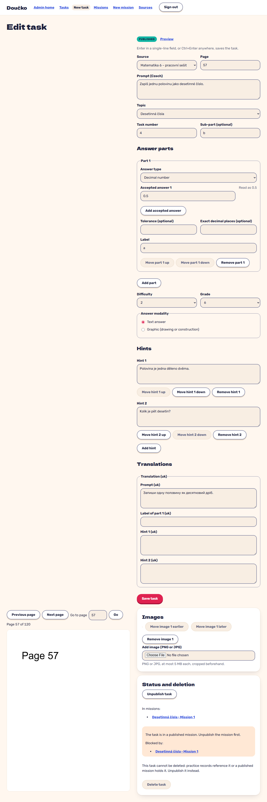

# A task in a published mission: unpublish refused, delete blocked (FR-55)

**Proves:** FR-55

**Result:** asserted ✓

With the seeded mission and its tasks published, open the task editor and unpublish the task. Asserted: the refusal names the mission with a link, the task stays PUBLISHED, and delete is disabled with the explanation offering to unpublish instead. The still shows the status and deletion panel.

Recorded against the production build (`vite preview`) with the admin API answered by the contract stub `src/test/fake-admin-backend.ts` (self-authored data). The real-stack click path is task 4.4 of implement-authoring-missions-ui (after the slice 6 merge).

