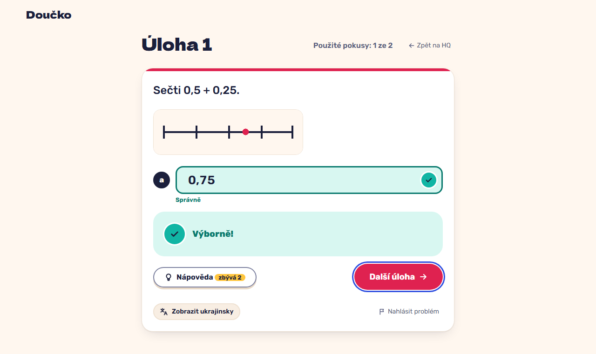

# Correct on the first attempt: "Výborně!" and "Další úloha" (FR-26, FR-27, NFR-7)

**Proves:** FR-26, FR-27, NFR-7

**Result:** asserted ✓

On the task with an image, type 0,75 and press Enter. Asserted: the image is shown, the answer is graded correct, the part locks and "Další úloha" takes focus. The still shows the solved task.

Recorded at 1280×720 against the production build (`vite preview`) with the child API answered by the contract stub `src/test/fake-child-backend.ts` (self-authored practice seed, fictional display name). The real-stack click path is task 4.4 of implement-practice-flow-ui (after the slice 7 merge).

