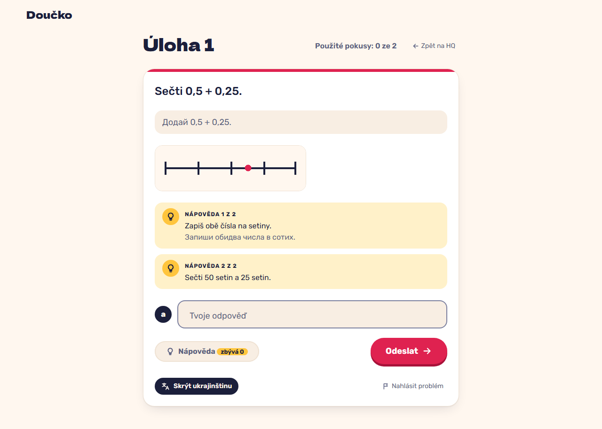

# Hints in order and the Ukrainian translation next to the Czech (FR-28, FR-29)

**Proves:** FR-28, FR-29

**Result:** asserted ✓

Open both hints one at a time, then turn on "Zobrazit ukrajinsky". Asserted: the hint counter goes 2 → 1 → 0 and the button ends disabled, both hints are recorded, the profile setting is uk and the Ukrainian prompt and hint 1 show next to the Czech while the buttons stay Czech. The still shows the translated task with its hints.

Recorded at 1280×720 against the production build (`vite preview`) with the child API answered by the contract stub `src/test/fake-child-backend.ts` (self-authored practice seed, fictional display name). The real-stack click path is task 4.4 of implement-practice-flow-ui (after the slice 7 merge).

