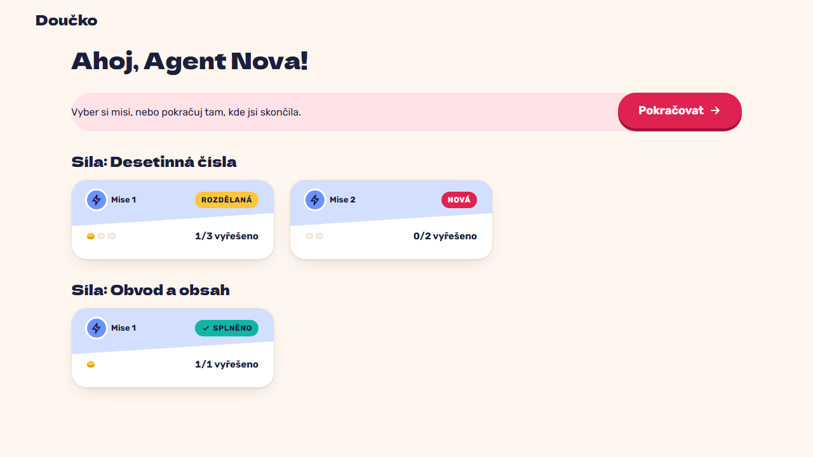

# HQ without login: missions by topic with x/N vyřešeno and their states (FR-24, FR-25, NFR-7)

**Proves:** FR-24, FR-25, NFR-7

**Result:** asserted ✓

With one task of mission 1 resolved and the perimeter mission revealed, open the app. Asserted: HQ greets the fictional profile with no login form, the topics are grouped with mission 1 before mission 2, the cards show 1/3 in progress, 0/2 new and 1/1 complete, the draft mission has no card, and "Pokračovat" is offered. The still shows HQ.

Recorded at 1280×720 against the production build (`vite preview`) with the child API answered by the contract stub `src/test/fake-child-backend.ts` (self-authored practice seed, fictional display name). The real-stack click path is task 4.4 of implement-practice-flow-ui (after the slice 7 merge).

