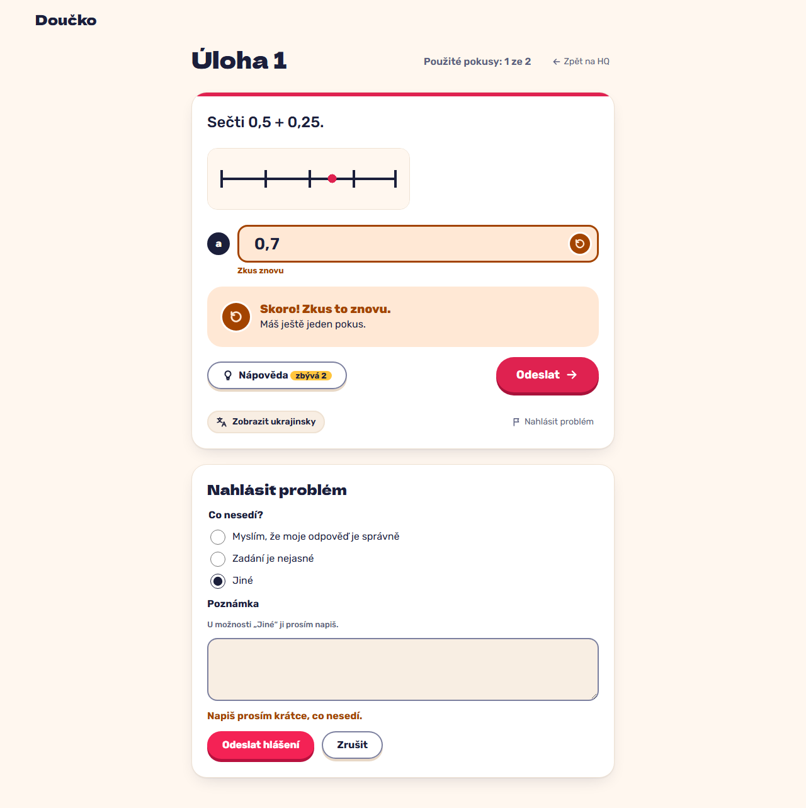

# "Nahlásit problém": the attempt attached, thanks, attempts unchanged; "Jiné" needs a note (FR-30)

**Proves:** FR-30

**Result:** asserted ✓

After a wrong attempt report "Myslím, že moje odpověď je správně", then open the dialog again and send "Jiné" without a note. Asserted: the first report is stored with the raw attempt, "Díky, podívám se na to!" is shown and 1 attempt is still left; the second is refused with "Napiš prosím krátce, co nesedí." The still shows the dialog.

Recorded at 1280×720 against the production build (`vite preview`) with the child API answered by the contract stub `src/test/fake-child-backend.ts` (self-authored practice seed, fictional display name). The real-stack click path is task 4.4 of implement-practice-flow-ui (after the slice 7 merge).

