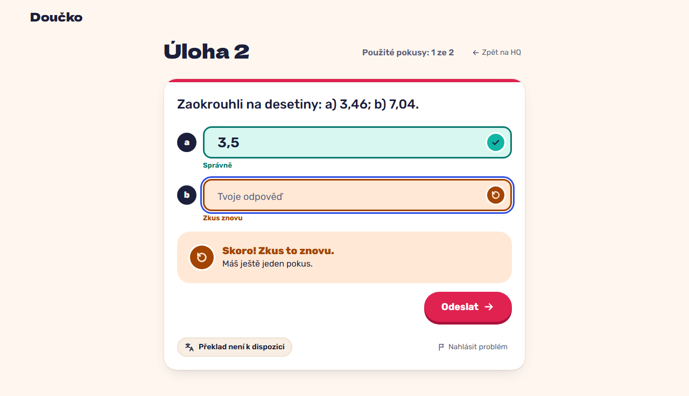

# Save and resume: a failed save keeps the input; reopening continues at the stored attempt (FR-31)

**Proves:** FR-31

**Result:** asserted ✓

With the backend unreachable submit 7,1 on the two-part task; with it back submit again; then open the app afresh and press "Pokračovat". Asserted: the failure message shows and nothing is stored, the retry is graded as attempt 1 (one attempt in the log), and the reopened app lands on that task with 1 of 2 used and b marked. The still shows the resumed task.

Recorded at 1280×720 against the production build (`vite preview`) with the child API answered by the contract stub `src/test/fake-child-backend.ts` (self-authored practice seed, fictional display name). The real-stack click path is task 4.4 of implement-practice-flow-ui (after the slice 7 merge).

