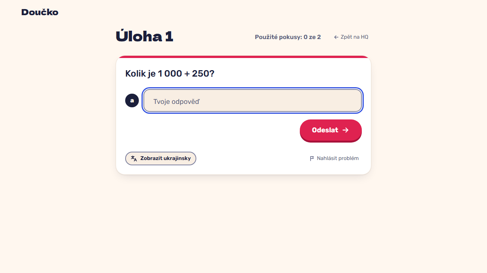

# Start a new mission in two clicks: card, then "Začít misi" (FR-25, FR-26, NFR-7)

**Proves:** FR-25, FR-26, NFR-7

**Result:** asserted ✓

On HQ click mission 2, see its briefing, click "Začít misi". Asserted: two clicks open task 1 of mission 2 with its prompt and focus in input a. The still shows the task screen.

Recorded at 1280×720 against the production build (`vite preview`) with the child API answered by the contract stub `src/test/fake-child-backend.ts` (self-authored practice seed, fictional display name). The real-stack click path is task 4.4 of implement-practice-flow-ui (after the slice 7 merge).

