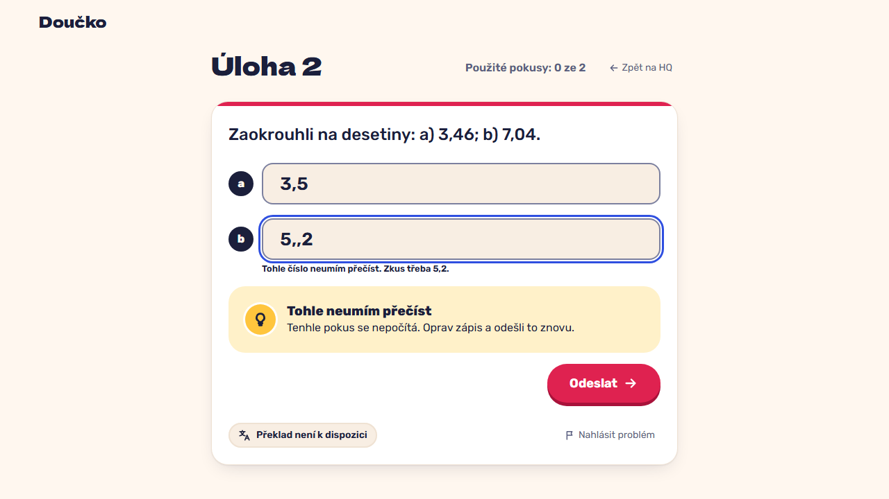

# Unreadable input: a format tip, the typed text kept, no attempt used (FR-22)

**Proves:** FR-22

**Result:** asserted ✓

On the two-part task type 3,5 and 5,,2 and press Enter. Asserted: b shows the format tip, keeps 5,,2, and the indicator still shows 0 of 2 attempts used; no attempt is stored. The still shows the tip.

Recorded at 1280×720 against the production build (`vite preview`) with the child API answered by the contract stub `src/test/fake-child-backend.ts` (self-authored practice seed, fictional display name). The real-stack click path is task 4.4 of implement-practice-flow-ui (after the slice 7 merge).

