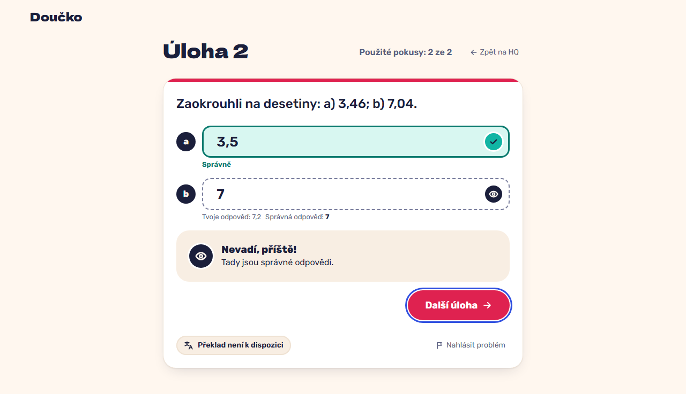

# Two attempts, then the reveal: wrong part in "almost", right part locked, answers shown neutrally (FR-27)

**Proves:** FR-27

**Result:** asserted ✓

On the two-part task answer a right and b wrong, then b wrong again. Asserted: after attempt 1 b shows "Zkus znovu", a is locked and 1 of 2 attempts is used, without the correct value of b; after attempt 2 "Nevadí, příště!" and the correct answers are shown, the inputs are read-only and nothing says "Špatně" or "Chyba". The still shows the reveal.

Recorded at 1280×720 against the production build (`vite preview`) with the child API answered by the contract stub `src/test/fake-child-backend.ts` (self-authored practice seed, fictional display name). The real-stack click path is task 4.4 of implement-practice-flow-ui (after the slice 7 merge).

