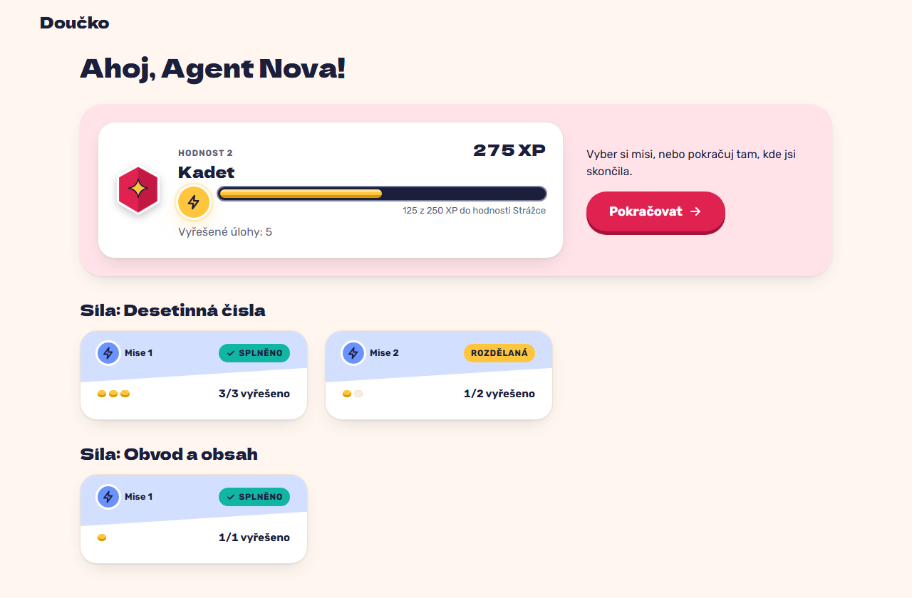

# HQ progress: rank, XP bar towards the next rank and solved tasks (FR-37)

**Proves:** FR-37

**Result:** asserted ✓

After 5 solved tasks (90 XP) and a 185 XP credit already celebrated (275 XP), open HQ. Asserted: the progress panel shows the 2nd rank "Kadet" (Hodnost 2), 275 XP, the bar at 125 of 250 XP with "125 z 250 XP do hodnosti Strážce", and "Vyřešené úlohy: 5"; no minus sign, timer or streak. The still shows HQ.

Recorded at 1280×720 against the production build (`vite preview`) with the child API answered by the contract stub `src/test/fake-child-backend.ts` (self-authored practice seed, placeholder rank ladder, fictional display name). The real-stack click path is task 4.4 of implement-gamification-ui (after the slice 8 merge).

