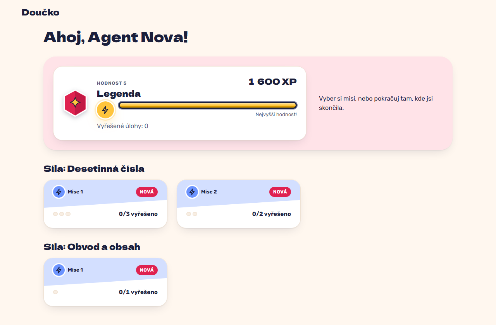

# HQ at the top rank: a full bar marked "Nejvyšší hodnost!" with no next target (FR-37)

**Proves:** FR-37

**Result:** asserted ✓

With 1600 XP open HQ. Asserted: the 5th rank "Legenda", "1 600 XP" with a no-break space, a full bar, "Nejvyšší hodnost!" and no "do hodnosti" target. The still shows HQ.

Recorded at 1280×720 against the production build (`vite preview`) with the child API answered by the contract stub `src/test/fake-child-backend.ts` (self-authored practice seed, placeholder rank ladder, fictional display name). The real-stack click path is task 4.4 of implement-gamification-ui (after the slice 8 merge).

