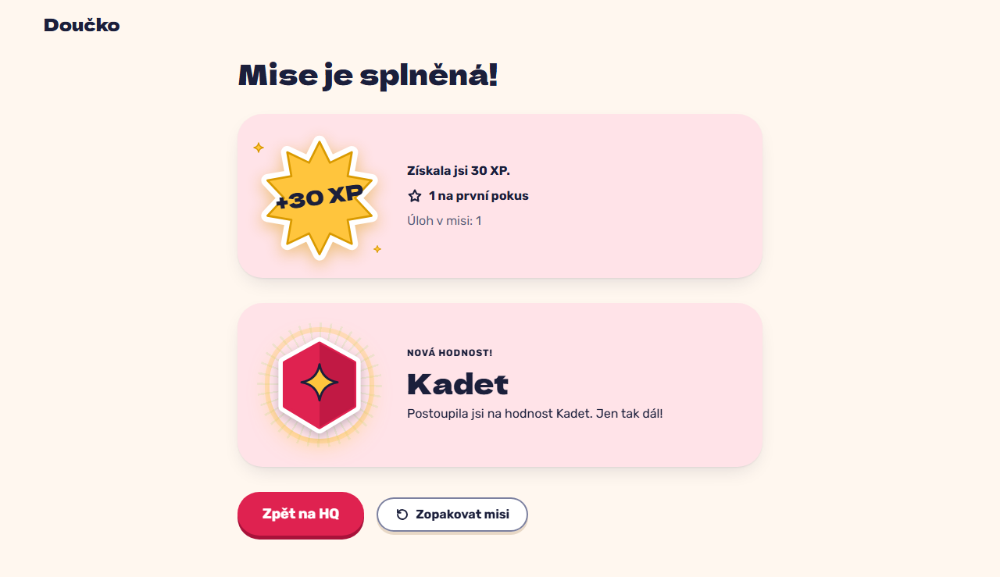

# Mission complete with a rank-up: the celebration on the summary, then a static line on return (FR-32, FR-36)

**Proves:** FR-32, FR-36

**Result:** asserted ✓

With 140 XP, solve the only task of the perimeter mission (10 XP + 20 XP bonus). Asserted: the task screen shows no celebration; "Výsledky mise" opens the summary with "+30 XP" and the celebration naming "Kadet", acknowledged once. The still shows the summary with the celebration; afterwards a reload lists "Nová hodnost: Kadet" statically.

Recorded at 1280×720 against the production build (`vite preview`) with the child API answered by the contract stub `src/test/fake-child-backend.ts` (self-authored practice seed, placeholder rank ladder, fictional display name). The real-stack click path is task 4.4 of implement-gamification-ui (after the slice 8 merge).

