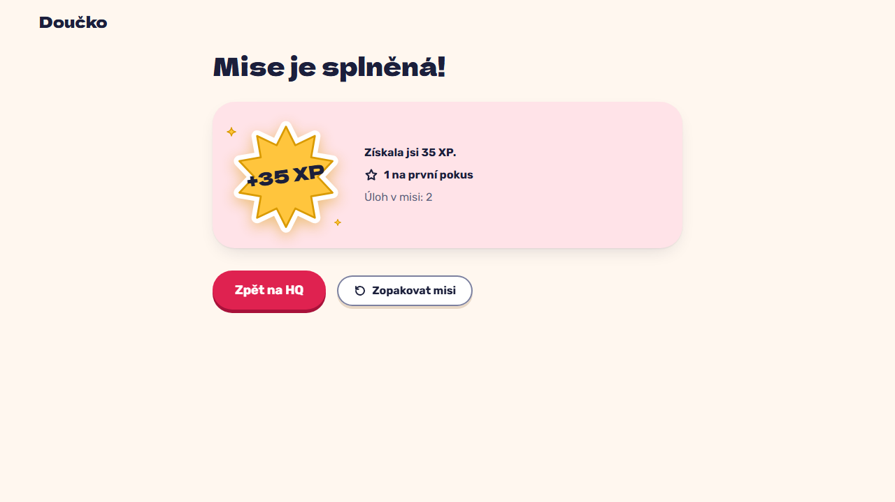

# Mission complete: XP earned in the run, first-try count, from the last task by keyboard (FR-32)

**Proves:** FR-32, FR-38

**Result:** asserted ✓

Mission 2 with task 1 solved first time; answer task 2 wrong, then right. Asserted: "+5 XP" and "+20 XP bonus za splněnou misi", focus on "Výsledky mise"; Enter opens "Mise je splněná!" with "+35 XP", "Získala jsi 35 XP.", "1 na první pokus" and "Úloh v misi: 2", and no celebration. The still shows the mission-complete screen.

Recorded at 1280×720 against the production build (`vite preview`) with the child API answered by the contract stub `src/test/fake-child-backend.ts` (self-authored practice seed, placeholder rank ladder, fictional display name). The real-stack click path is task 4.4 of implement-gamification-ui (after the slice 8 merge).

