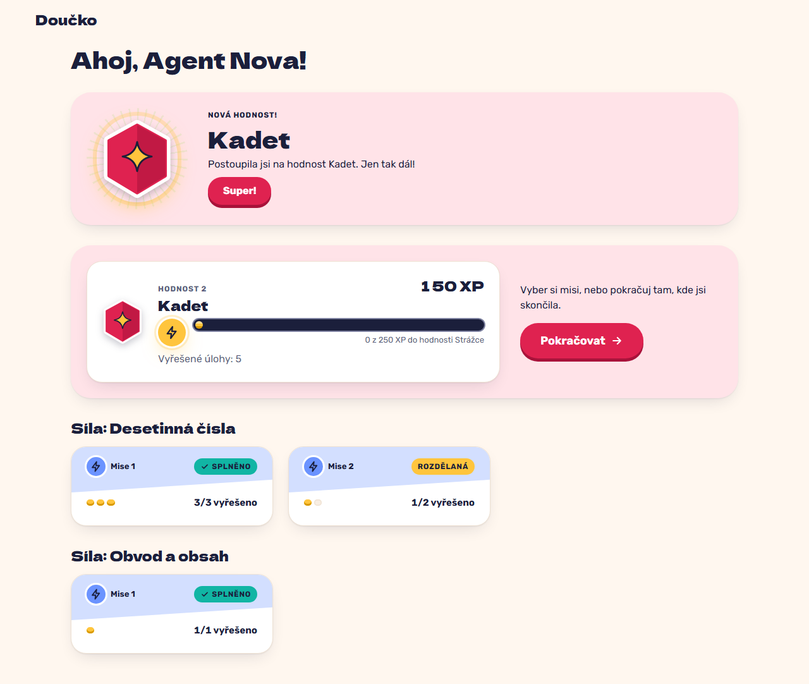

# A rank-up credited outside a session is celebrated once on HQ and acknowledged (FR-36)

**Proves:** FR-36

**Result:** asserted ✓

After 5 solved tasks (90 XP), a 60 XP credit outside a child session takes the total to 150 XP; open HQ. Asserted: the celebration names the new rank "Kadet" with the medal and "Nová hodnost!", it animates, the client acknowledges rank 1 exactly once, and a reload shows no celebration. The still is the celebration on HQ, taken before the reload.

Recorded at 1280×720 against the production build (`vite preview`) with the child API answered by the contract stub `src/test/fake-child-backend.ts` (self-authored practice seed, placeholder rank ladder, fictional display name). The real-stack click path is task 4.4 of implement-gamification-ui (after the slice 8 merge).

