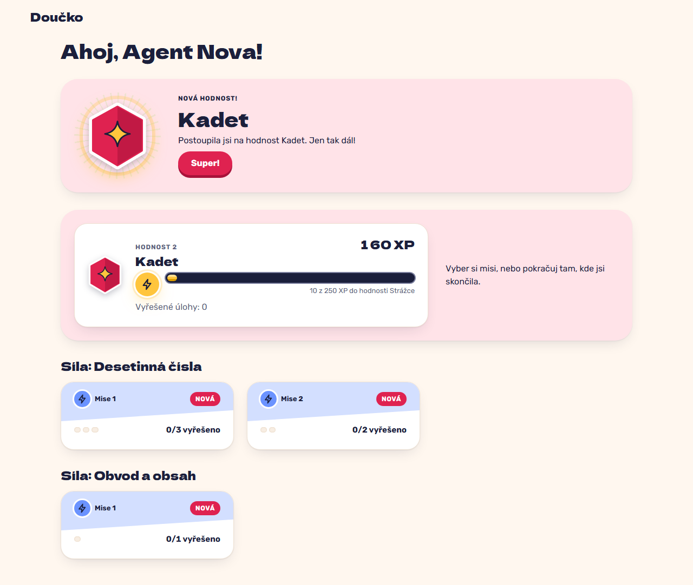

# The rank-up celebration under reduced motion: same text and medal, nothing moves (FR-36, NFR-13)

**Proves:** FR-36, NFR-13

**Result:** asserted ✓

The same pending rank-up, with the OS asking for reduced motion. Asserted: the celebration shows the same text ("Nová hodnost!", the rank name, the sentence) and the medal, and no animation exists on the page. The still shows it.

Recorded at 1280×720 against the production build (`vite preview`) with the child API answered by the contract stub `src/test/fake-child-backend.ts` (self-authored practice seed, placeholder rank ladder, fictional display name). The real-stack click path is task 4.4 of implement-gamification-ui (after the slice 8 merge).

