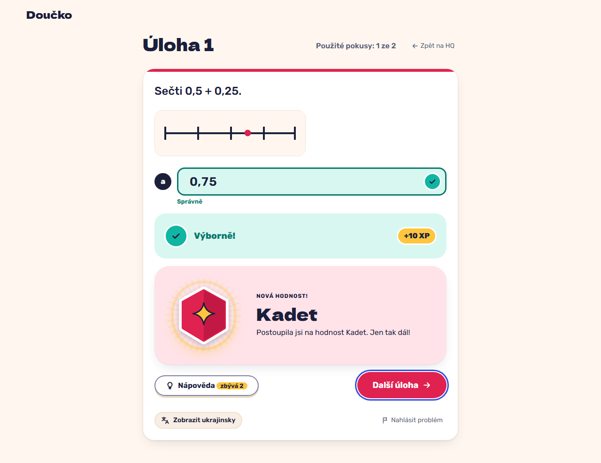

# A task award crossing a threshold mid-mission celebrates on the feedback with "+10 XP" (FR-36, FR-38)

**Proves:** FR-36, FR-38

**Result:** asserted ✓

With 145 XP, answer task 1 of mission 1 correctly with the keyboard. Asserted: "Výborně!" with "+10 XP", the celebration naming "Kadet" under the feedback, focus on "Další úloha", no acknowledgement needed (the answer carried it). The still shows the task.

Recorded at 1280×720 against the production build (`vite preview`) with the child API answered by the contract stub `src/test/fake-child-backend.ts` (self-authored practice seed, placeholder rank ladder, fictional display name). The real-stack click path is task 4.4 of implement-gamification-ui (after the slice 8 merge).

