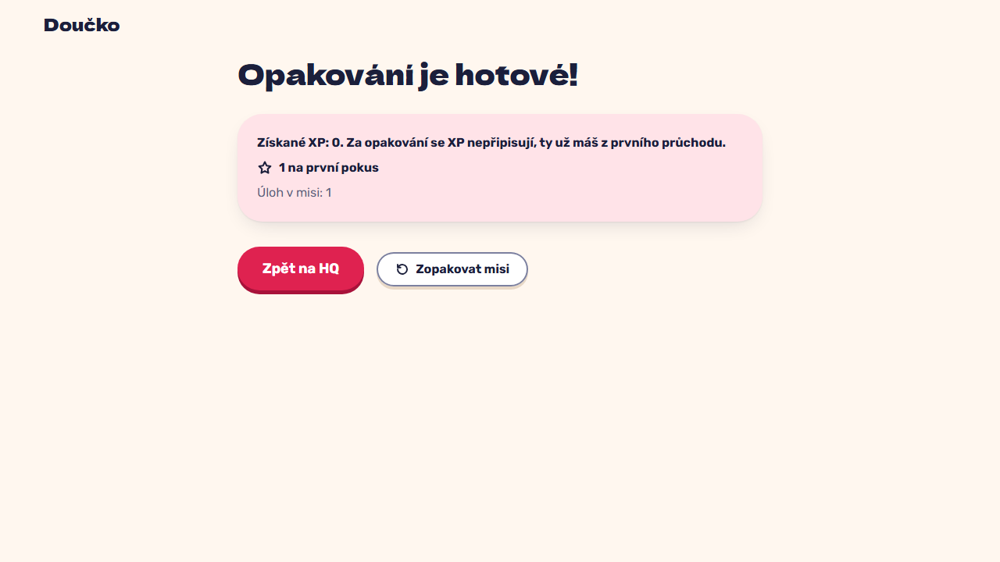

# Replay a completed mission: fresh attempts, no XP, mission stays complete on HQ (FR-33)

**Proves:** FR-33, FR-32

**Result:** asserted ✓

With the perimeter mission completed, open its briefing and press "Zopakovat misi". Asserted: the task opens with 0 of 2 attempts used and an empty input; a correct answer shows no XP; "Výsledky mise" opens "Opakování je hotové!" with the replay note (0 XP); the total XP is unchanged. The still shows the replay summary.

Recorded at 1280×720 against the production build (`vite preview`) with the child API answered by the contract stub `src/test/fake-child-backend.ts` (self-authored practice seed, placeholder rank ladder, fictional display name). The real-stack click path is task 4.4 of implement-gamification-ui (after the slice 8 merge).

